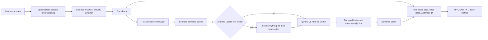
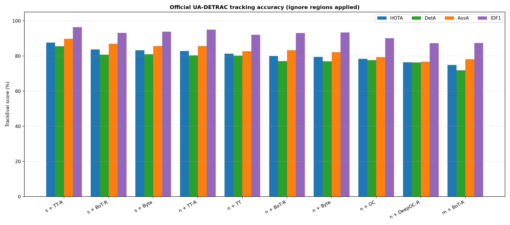
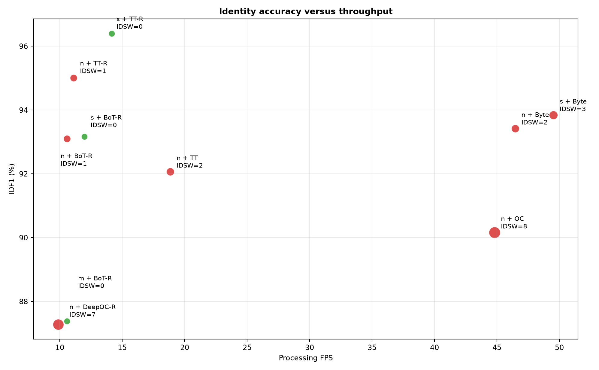

# Realtime Traffic Tracking With Qwen Semantics

This repository implements a task-configured video pipeline that detects road users, assigns
stable track IDs, and enriches selected tracks with deeper labels from
`Qwen/Qwen3-VL-4B-Instruct` 8-bit. Accuracy-oriented offline runs can first use
LocateAnything-3B 8-bit to refine the target region; Qwen remains the semantic decision model.

The main runtime is deliberately explicit. A task file states what the user wants to track,
which detector checkpoint to use, which labels are valid, and which attributes matter. The
system does not guess the deployment objective from a few opening frames.

## Main Pipeline



The detector and tracker process incoming frames; stale frames may be dropped in live mode.
Qwen receives only bounded evidence for a
persistent track: a scene view with the target highlighted and up to two high-quality crops
from different times. A semantic result is attached to the `track_id` and reused on later
frames. This avoids running a 4B model on every frame.

### Design choices

- **Detector is selected per task.** Use a fine-tuned checkpoint for a private dataset, a
  pretrained YOLO checkpoint for known classes, or YOLOE with an explicit text vocabulary.
- **TrackTrack is the default tracker.** The traffic quality results are reported below. OC-SORT,
  ByteTrack, BoT-SORT ReID, DeepSORT, Deep OC-SORT ReID, and FastTracker remain benchmark
  profiles.
- **Base labels appear immediately.** Deep labels initially show `waiting` or `pending`, then
  change to an accepted Qwen label or `unknown`.
- **Class stabilization is temporal.** Short detector-class flips do not immediately change a
  persistent track's class.
- **Semantic work is bounded.** One pending job is retained per track; a better crop can replace
  a weaker pending crop without creating an unbounded queue.
- **Unknown is a valid result.** A vehicle subtype, color, make, or model is not rendered as fact
  unless confidence, margin, taxonomy, and temporal checks pass.
- **LocateAnything is localization evidence, not a class voter.** In deferred quality mode it
  refines a partly occluded target crop before Qwen, but cannot overwrite Qwen's semantic label.

Live mode uses Qwen alone because a second 3B model adds substantial latency on one 8 GB GPU.
Deferred quality mode runs LocateAnything and Qwen sequentially so their VRAM peaks do not
overlap. This gives Qwen both temporal track evidence and a refined spatial crop.

## Requirements

- Windows PowerShell
- 64-bit Python 3.12
- Git for cloning the repository and optional TrackEval research dependencies
- NVIDIA GPU recommended; the measured machine used an RTX 4060 Laptop GPU with 8 GB VRAM
- A CUDA-enabled PyTorch build matching the installed NVIDIA driver

### Install after cloning

```powershell
git clone https://github.com/hieulenho/Football-Player-Detection-and-Multi-Object-Tracking-using-YOLOv8m-and-DeepSORT.git Tracking
cd Tracking
Set-ExecutionPolicy -Scope Process Bypass
.\scripts\setup_webcam.ps1
```

Setup selects CUDA when NVIDIA is available, otherwise CPU. CUDA installs
`requirements/runtime.txt` plus `requirements/qwen.txt`; CPU installs detection/tracking only.
TrackEval and research report tools are optional; Ultralytics brings its own common dependencies.
Public checkpoints are downloaded on first
use and are not stored in Git.

If Python is missing, install it with `winget install -e --id Python.Python.3.12`,
then reopen PowerShell. `-PythonExecutable` also accepts a full Python 3.12 executable path.
No data or model path is tied to the original development machine.

The shortest local webcam/video command is:

```powershell
.\scripts\run_traffic.ps1 -Source 0
.\scripts\run_traffic.ps1 -Source "C:\Videos\traffic.mp4" -RunName traffic_demo
```

CPU-only setup and execution:

```powershell
.\scripts\setup_webcam.ps1 -TorchBackend cpu
.\scripts\run_traffic.ps1 -Source 0 -Device cpu -SemanticWorkerMode disabled
```

CPU mode does not produce Qwen deep labels. To prefetch weights before a CUDA run,
use `setup_webcam.ps1 -TorchBackend cuda -DownloadModels`. Qwen weights download in
their original format and are quantized to 8-bit at model load, not stored as an
8-bit download. The default traffic profile does not load YOLOE or LocateAnything.

Optional YOLOE open-vocabulary support:

```powershell
.\.venv\Scripts\python.exe -m pip install -r requirements\open_vocab.txt
```

Optional LocateAnything support for deferred quality runs and grounding ablations:

```powershell
.\.venv\Scripts\python.exe -m pip install -r requirements\locate_tracking.txt
```

Verify an existing environment:

```powershell
.\scripts\setup_webcam.ps1 -VerifyOnly
nvidia-smi
```

## Run The Pipeline

### Webcam

```powershell
.\scripts\run_task_webcam.ps1 `
  -TaskConfig configs\tasks\traffic_realtime.yaml `
  -CameraIndex 0 `
  -RunName webcam_traffic `
  -SemanticWorkerMode live `
  -LiveSemanticMaxPendingEvents 4 `
  -Overwrite
```

`CameraIndex` is a logical inventory shared by local webcams and RTSP cameras. Local webcams
are listed first; discoverable RTSP cameras follow. Therefore the same command can open a
Yoosee stream at index 1 without installing a virtual-camera driver, provided the camera is on
the same network and its RTSP service is enabled. Inspect the current mapping with:

```powershell
.\scripts\run_task_webcam.ps1 `
  -TaskConfig configs\tasks\traffic_realtime.yaml `
  -ListOnly
```

The preview opens automatically. Press `Q` or `Esc` to stop. `live` keeps Qwen loaded in a
separate process and updates labels while capture continues. The detector label is immediate;
the first deep label is delayed by model loading, evidence collection, and generation.
On the measured RTX 4060 Laptop 8 GB system, the verified grouped traffic run averaged
14.24 seconds per two-track Qwen batch after model reuse, with a roughly 23.5-second cold load.
The live queue therefore defaults to four in-flight tracks; raising it increases label wait time
and disk work rather than model throughput.

Use `-SemanticWorkerMode disabled` to measure detector/tracker throughput, or `deferred` when
processing a file on one 8 GB GPU and final labels are allowed to appear after tracking ends.
For dense traffic on a single 8 GB GPU, `disabled` preserves the highest foreground FPS and
`deferred` can process retained evidence without competing with the tracking loop. Concurrent
`live` Qwen inference competes with YOLO for the same GPU and cannot deeply label every
short-lived vehicle at camera rate.

### IP camera (Yoosee/ONVIF/RTSP)

A Yoosee IP camera is powered by its USB cable but normally sends video over the local network,
not as a Windows UVC webcam. Pair it with the Yoosee phone app on the same 2.4 GHz Wi-Fi, enable
the NVR/RTSP connection, set a dedicated NVR password, and find its DHCP address. Disable the
camera's own motion-following mode when evaluating tracker identity stability.

Use the low-resolution sub-stream for lower live latency:

```powershell
.\scripts\run_ip_camera.ps1 `
  -CameraIp 192.168.1.120 `
  -Stream sub `
  -TaskConfig configs\tasks\traffic_realtime.yaml `
  -RunName yoosee_traffic `
  -SemanticWorkerMode live `
  -Overwrite
```

The script asks for the NVR/RTSP password without echoing it, verifies three frames, then starts
the pipeline. Use `-Stream main` when image detail matters more than latency. Credentials are
passed through a temporary environment variable and are redacted from runtime metadata.
Yoosee firmware varies: when the app has no NVR/DVR, RTSP, or ONVIF option, obtain the exact
stream URL from the device manual or seller and pass it with `-RtspUrl`; a P2P-only firmware
cannot be converted into an RTSP source by this repository.

To avoid entering the RTSP password on every run, save it once with Windows DPAPI:

```powershell
.\scripts\save_camera_credential.ps1 -Username admin
```

The command prompts once and writes only an encrypted value under `.camera_credentials/`,
which is excluded from Git. It can be decrypted only by the same Windows account on the same
machine. Future `run_task_webcam.ps1`, `run_camera.ps1`, and `run_ip_camera.ps1` commands load
it automatically. Recreate it with `-Overwrite` after changing the NVR password.

For one index-style command across local and network cameras, first inspect the current
inventory and then select its logical index:

```powershell
.\scripts\run_camera.ps1 -ListOnly

.\scripts\run_camera.ps1 `
  -CameraIndex 1 `
  -TaskConfig configs\tasks\traffic_realtime.yaml `
  -RunName portable_camera `
  -SemanticWorkerMode live `
  -Overwrite
```

Local webcams are listed first and RTSP endpoints follow. RTSP discovery scans only port 554
on bounded private `/24` networks. Use `-ScanNetwork 192.168.137.0/24` to restrict discovery
to a Windows Mobile Hotspot subnet. Because this is a dynamic inventory rather than a Windows
device ID, run `-ListOnly` after changing adapters or networks before selecting 0, 1, or 2.

For portable use, give Windows Mobile Hotspot a fixed SSID and password, set its band to
2.4 GHz, and pair the camera with that hotspot once. The laptop may change its upstream Wi-Fi
while the camera continues to use the laptop hotspot. A small travel router is more reliable
for long unattended sessions. Connecting the laptop to an arbitrary new Wi-Fi does not move
the camera to that network automatically.

### Recorded video

```powershell
.\scripts\run_task_realtime.ps1 `
  -TaskConfig configs\tasks\traffic_realtime.yaml `
  -Source "C:\Videos\traffic.mp4" `
  -RunName traffic_01 `
  -OutputRoot outputs\traffic `
  -SemanticWorkerMode deferred `
  -Device cuda `
  -NoWindow `
  -Overwrite
```

Deferred mode first writes the complete MOT result, processes queued tracks in one persistent
Qwen session, then renders accepted labels back onto the video.

For the accuracy-first traffic profile, run LocateAnything before Qwen and keep one track per
prompt:

```powershell
.\scripts\run_task_realtime.ps1 `
  -TaskConfig configs\tasks\traffic_objects_quality.yaml `
  -Source "C:\Videos\traffic.mp4" `
  -RunName traffic_quality `
  -SemanticWorkerMode deferred `
  -LocateFirst `
  -DisableSemanticGrouping `
  -SemanticWorkerBatchSize 1 `
  -DisableFrameDropping `
  -SynchronousVideoWrite `
  -Device cuda `
  -NoWindow `
  -Overwrite
```

This command prioritizes identity and semantic quality, not realtime throughput.

### Provided task profiles

| Task file | Detector scope | Deep semantic objective |
|---|---|---|
| `traffic_realtime.yaml` | YOLO26n road users | Qwen subtype and visible color; lean live default |
| `traffic_objects.yaml` | traffic + sparse YOLOE proposals | experimental subtype hints and Qwen labels |
| `traffic_objects_quality.yaml` | YOLO26s + CNN ReID | accuracy-oriented subtype/color evaluation |
| `traffic_vehicles*_benchmark.yaml` | traffic classes | controlled detector/tracker comparisons |

For a private dataset, copy the closest task YAML, point `detector.checkpoint` to the trained
weights, set detector classes, and define the semantic instruction and taxonomy. The runtime
does not need a Detector Router when the deployment task is already known.

## Output Contract

Each run is isolated under `<OutputRoot>/<RunName>/`:

```text
runtime/task.resolved.json          exact task contract
runtime/tracking.generated.yaml     exact detector/tracker runtime
tracked_semantic.mp4                rendered result
tracked_semantic.txt                MOT rows
realtime_metrics.json               latency, FPS, coverage, resources
semantic_queue/                     atomic pending/processed/failed jobs
semantic_memory.json                bounded temporal evidence
semantic_cache.json                 accepted and rejected track labels
semantic_worker_report.json         Qwen timing and failures
```

MOT rows use:

```text
frame, track_id, x, y, width, height, confidence, class_id, visibility, reserved
```

The rendered label source matters:

- `base`: detector class only
- `waiting`: no semantic job yet
- `pending`: evidence is queued or currently being processed
- `accepted`: Qwen label passed fusion and rejection checks
- `unknown`: Qwen evidence was insufficient or conflicting

Coverage is not accuracy. A box having some label does not prove that its deep label is correct.

## Verified Results

### Traffic quality benchmark

The current official UA-DETRAC comparison covers ten detector/tracker combinations on 750
frames with all four dataset ignore regions applied. YOLO26s + TrackTrack CNN-ReID achieved
HOTA 87.605, IDF1 96.399, and 0 IDSW at 14.16 processing FPS. YOLO26s + ByteTrack was the
fastest measured profile at 49.52 FPS.

The corrected LocateAnything -> Qwen run processed 24 tracks. Eight tracks had official
vehicle-class GT and reached 87.5% parent-class accuracy, 85.45% Macro-F1, and 100% coverage.
Sixteen predictions were unscored because UA-DETRAC does not annotate every visible class or
ignore-region object. Fine subtype/color accuracy and unknown-rejection F1 remain N/A until
reviewed GT for those labels exists.

See the [traffic quality report](docs/benchmarks/traffic_quality/traffic_quality_report.md) and
its [artifact audit](docs/benchmarks/traffic_quality/artifact_audit.json).

Machine-readable tables, plots, hashes and limitations are retained with the
[traffic report](docs/benchmarks/traffic_quality/traffic_quality_report.md).
The measured queue and concurrent-Qwen behavior for a dense traffic stream is documented in
the [dense traffic live semantic benchmark](docs/benchmarks/dense_traffic_live_semantics.md).
The latest machine-readable deep-label verification is
[traffic_deep_labels_verified.json](docs/benchmarks/traffic_deep_labels_verified.json).
The longer local YouTube stress tests are recorded in
[youtube_traffic_exploratory.json](docs/benchmarks/youtube_traffic_exploratory.json).





These are saved file-benchmark measurements, not webcam capture-to-display latency.
Their protocol and hardware must accompany any comparison; the lean live default
must not be assigned another profile's accuracy or FPS.

## Reproduce Research Artifacts

```powershell
.\.venv\Scripts\python.exe -m pip install -r requirements\dev.txt
.\.venv\Scripts\python.exe -m ruff check src scripts tests
.\.venv\Scripts\python.exe -m pytest -q
```

See [benchmark instructions](docs/BENCHMARKS.md) for dataset preparation, GT-backed
tracking and semantic evaluation. Dataset annotations and original run artifacts
are required to regenerate measurements; a clone does not contain private videos.
See [usage and troubleshooting](docs/USAGE.md) for execution details.

## Scientific Limits

- Official detector/tracker claims use GT. The five-way IDSW subtype split is a heuristic
  diagnostic; only total TrackEval IDSW is official.
- Fine subtype/color accuracy needs independently reviewed GT; it is not inferred
  from coverage or from the vehicle parent-class benchmark.
- The formal 900-frame webcam foreground benchmark measures capture, detection, tracking,
  rendering, and queue bookkeeping. Qwen generation latency is reported separately.
- A current TaskConfig camera smoke was limited by a camera source delivering about 1 FPS; it
  verifies integration but is not a model-throughput result.
- No system can guarantee a deep label for every fast or occluded object. The safe output is
  the stable base detector class plus `unknown` when evidence is insufficient.

## Repository Layout

```text
configs/tasks/                 deployment intent and taxonomy
configs/trackers/              tracker profiles
configs/benchmarks/            measurement contracts
src/football_tracking/task_pipeline/  TaskConfig validation/building
src/football_tracking/tracking/       detector-to-track runtime
src/football_tracking/adaptive_tracking/ semantic queue/fusion/cache
scripts/run_traffic.ps1        simple camera/video entrypoint
scripts/run_task_realtime.ps1  advanced file/stream entrypoint
scripts/run_task_webcam.ps1    primary webcam entrypoint
scripts/benchmarks/            reproducible evaluation tools
docs/benchmarks/traffic_quality/ traffic report, CSVs, and figures
tests/                         regression and contract tests
```

## License

See [LICENSE](LICENSE) and [third-party notices](NOTICE.md). Datasets, dependencies
and model checkpoints retain their original licenses.

The repository URL and internal `football_tracking` package retain their historical
names for compatibility; neither requires football data or football-trained weights.
